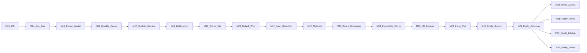

# Kona milestones

Single source of truth for milestone status and Definition of Done.  
Working rules: [AGENTS.md](AGENTS.md). Architecture: [docs/architecture/PLAN.md](docs/architecture/PLAN.md).

**Active milestone:** [M31](#m31--firefly-forms) — **Kona Firefly** forms, complete on `milestone/M31-firefly-forms` and on `main` when this PR merges.

On `main` (`0bd0c321`, including #219): M28 support, M29 schemas, M30 actions, M32 infolists, M33 tables. `modules/firefly-forms` is not on `main` until this PR merges. M34–M38 are queued and not started. Kona **0.3.0** (M26) has shipped.

Law 1 still allows parallel non-colliding milestones, each on its own branch and pull request. This status line records what is on `main`. It does not collapse that rule back to a single active milestone.

Pages, widgets, and resources compose the schemas, forms, infolists, actions, and tables that can already render on their own. A later milestone cannot ship by only rendering a form, infolist, table, or widget in isolation. The integration contract is part of M34, M35, and M36 parity below. Those three stay queued and not done. Do not pull M36 forward ahead of M31 landing.

Public site docs (`apps/docs/`, Astro + Starlight + `@almasix/starlight-theme`) are written **concurrently** with each coding milestone — see [docs/governance/docs-site.md](docs/governance/docs-site.md).  
Continuous delivery drill: [docs/governance/continuous-autopilot.md](docs/governance/continuous-autopilot.md). Handoff: [docs/governance/HANDOFF.md](docs/governance/HANDOFF.md).

This plan targets **full Almasix menu parity** (behavioral/API shape). Prefer Almasix where both exist; use Laravel as the named equivalent for gaps. Continuous autopilot runs **through M13** (not stopping at the old M5).

---

## Global Definition of Done (every coding milestone)

- [ ] Parity checklist for the milestone is 100% complete (Laravel and/or Almasix slice).
- [ ] 100% line + branch coverage on in-scope production modules (Kover/JaCoCo; CI enforced).
- [ ] Full regression suite green (this milestone + all prior completed milestones).
- [ ] Kotlin sample and Java sample (or regression paths) exercise new public API.
- [ ] Public docs for the slice updated under `apps/docs/` (guides + sidebar; progressive simple-first where possible).
- [ ] Milestone PR merged to `main` via required checks + automerge.
- [ ] `MILESTONES.md` updated: this milestone marked **done**. Other milestones stay on their own branches. Do not open a milestone that depends on this one until it is on `main`.

---

## Almasix parity coverage ledger

Every topic from the Almasix docs menu maps to a milestone. Agents must not close the continuous session until every row is **done**.

### The basics

| Topic | Milestone | Status |
|-------|-----------|--------|
| Routing | M1 | done |
| Controllers | M1 (basic); deepen in M5 | implemented (checklist) |
| Requests | M1 | done |
| Responses | M1 | done |
| API Resources | M5 | implemented (checklist) |
| Middleware | M1 | done |
| CSRF Protection | M3 | implemented (checklist) |
| Validation | M1 | done |
| Views (Crema) | M6 | implemented (checklist) |
| Asset Bundling | M12 | done |
| URL Generation | M5 | implemented (checklist) |
| Session | M3 | implemented (checklist) |
| Authentication | M3 | implemented (checklist) |
| Hashing | M3 | implemented (checklist) |
| Passwords | M3 | implemented (checklist) |
| Error Handling | M1 (basic); deepen in M5 | implemented (checklist) |
| Logging | M1 (basic); deepen in M5 | implemented (checklist) |
| Security headers & CORS | M3 | implemented (checklist) |
| Rate Limiting | M3 | implemented (checklist) |

### Deeper

| Topic | Milestone | Status |
|-------|-----------|--------|
| Smith Console → `grind` depth + `steam` | M8 | done |
| Prompts | M8 | done |
| Task Scheduling | M8 | done |
| File Storage | M7 | done |
| Queues | M7; durable deepen M16 | done |
| Mail | M7 | done |
| Notifications | M7 | done |
| Collections | M4 | done |
| Helpers | M4 | done |
| Dates (Carbon/Chrono-class) | M4 | done |
| Strings | M4 | done |
| Localization | M4 | done |
| Cache | M4 | done |
| Redis | M4 | done |
| Events | M7 | done |
| Broadcasting | M10 | implemented (checklist) |
| HTTP Client → `drip` | M9 | implemented (checklist) |
| Processes | M9 | implemented (checklist) |
| Concurrency | M9 | implemented (checklist) |
| Search | M10 | implemented (checklist) |
| Package Development | M8 | done |
| Livewire / Conduit-class reactive UI | M11 (Brew); rename → **Kona Wire** in M26 (`0.3.0`) | done (rename queued) |
| Inertia | M12 | done |
| Starter Kits | M12 | done |

### Security

| Topic | Milestone | Status |
|-------|-----------|--------|
| Authorization (Gates, Policies) | M3 | implemented (checklist) |
| API Tokens | M3 | implemented (checklist) |
| Encryption | M3 | implemented (checklist) |

### Database

| Topic | Milestone | Status |
|-------|-----------|--------|
| Query Builder | M2 | done |
| Pagination | M2 | done |
| Migrations | M2 | done |
| Seeding | M2 | done |
| Factories | M2 | done |
| MongoDB / document stores | **M27 (Kona 1.x)** — Cadence Document family, not an M25 SQL engine | queued (human-gated) |

### Cadence ORM

| Topic | Milestone | Status |
|-------|-----------|--------|
| Cadence: Getting Started (docs) | M2; Eloquent-depth rewrite (post-M13 parity) | done |
| Relationships | M2; morphs / through M15 | done |
| Mutators & Casts | M2; `CastsAttributes` M15 | done |
| Serialization | M4 | done |
| Collections (Cadence) | M4 | done |
| Soft Deletes & Events | Soft deletes M2; model events M4 | done |
| Document models (MongoDB) | **M27 (Kona 1.x)** | queued (human-gated) |

Living deepen ledger (Eloquent + Database engines/grammars): [docs/governance/cadence-eloquent-parity.md](docs/governance/cadence-eloquent-parity.md). MongoDB is **not** another JDBC grammar — see [M27](#m27--cadence-document--mongodb-kona-1x).

### View layer (Crema)

| Topic | Milestone | Status |
|-------|-----------|--------|
| Crema: Getting Started | M6 | done |
| Rendering Views | M6 | done |
| Layouts & Inheritance | M6 | done |
| Components & Slots | M6 | done |
| Control Structures | M6 | done |
| Including Subviews | M6 | done |
| Stacks & Directives | M6 | done |

### Language / editor

| Topic | Milestone | Status |
|-------|-----------|--------|
| Language support | M13 | done |
| Language server | M13 | done |
| Editor setup | M13 | done |

### Testing

| Topic | Milestone | Status |
|-------|-----------|--------|
| Testing: Getting Started | M9 | implemented (checklist) |
| HTTP Tests | M9 | implemented (checklist) |
| Console Tests | M9 | implemented (checklist) |
| Database Testing | M9 | implemented (checklist) |
| Mocking | M9 | implemented (checklist) |

---

## M0 — Plan + rules lock

**Status:** done  
**Branch:** `milestone/M0-plan` (merged)  
**Parity scope:** N/A (process)

### Deliverables

- [x] GitHub repo `konaframework/kona`
- [x] `docs/architecture/PLAN.md` (canonical architecture plan)
- [x] `docs/architecture/components.md` (component map)
- [x] `AGENTS.md` (agent laws)
- [x] `.cursor/rules/kona-milestones.mdc` (`alwaysApply`)
- [x] `MILESTONES.md` (this file)
- [x] `README.md` + `LICENSE`
- [x] Merged to `main`

### DoD

- [x] Docs on `main`; agents can enforce rules from a fresh clone.

---

## M1 — Kona kernel + HTTP + grind

**Status:** done  
**Branch:** `milestone/M1-completion` (merged; scaffold was `milestone/M1-kernel-http-grind`)

**Parity slice:** Laravel Application / Container / Providers / Config / Routing / HTTP Kernel / Middleware / Validation + Artisan `serve` / `make` ≈ Almasix `framework` / `http` / `routing` / console bootstrap.

### Parity checklist

Quality + parity audits: [docs/quality/M1-architecture-review.md](docs/quality/M1-architecture-review.md), [docs/quality/M1-parity-audit.md](docs/quality/M1-parity-audit.md).  
**Verdict: complete** on `main`.

- [x] Application boot (`Kona.start` + `Kona.create().providers().boot()` builder)
- [x] Service container (bind / singleton / resolve / autowire / thread-safe / cycles)
- [x] Service providers (register / boot — all register before any boot)
- [x] Config + env (nested dotted keys; file/directory load; env precedence)
- [x] HTTP request / response (typed data, headers, HEAD body strip)
- [x] Middleware pipeline (global wraps routing + errors; configurable)
- [x] Router (groups, prefixes, named routes, resource, HEAD→GET, 405/Allow, OPTIONS, `any`)
- [x] Kotlin route DSL **and** Java fluent registration (prefix/name/middleware/group)
- [x] Exception handling (JSON envelope; Allow on 405; validation 422)
- [x] Logging — basic facade
- [x] Validation (Laravel-shaped rules; fail unknown; type-aware min/max/size)
- [x] `grind serve` — runs generated app (`gradlew run` or `--in-process`)
- [x] `kona new` (`--lang=kotlin|java`) — global CLI; buildable Gradle app + local `./grind`
- [x] `grind make:controller` — basic + name validation
- [x] Kotlin hello sample — providers, groups, middleware via HttpKernel
- [x] Java hello sample — groups, middleware, providers (Law 8)
- [x] Parity inspection vs Laravel/Almasix (audits updated; blockers closed)

### In-scope modules

`kona-core`, `kona-http`, `kona-grind` (as introduced)

### Deferred deepen (tracked elsewhere)

Controllers (resource/API depth) → M5; Error Handling / Logging channels → M5.

---

## M2 — Cadence

**Status:** done  
**Branch:** `milestone/M2-extract` (merged)

**Parity slice:** Eloquent / Almasix ORM (core).

### Parity checklist

- [x] Connection manager
- [x] Query builder
- [x] Models (ActiveRecord)
- [x] Relations: hasOne, hasMany, belongsTo, belongsToMany
- [x] Eager loading
- [x] Pagination
- [x] Soft deletes
- [x] Casts
- [x] Migrations + schema DSL (Kotlin) / builder (Java)
- [x] Seeders
- [x] Factories
- [x] `grind make:model` / `make:migration` / `migrate`

### In-scope modules

`kona-cadence`, `kona-grind` (database commands)

### Deferred deepen (tracked elsewhere)

Cadence Serialization, Cadence Collections, Soft-delete / model **events** → M4. Getting Started docs rewrite (simple-first) continues with later waves.

---

## M3 — Session, auth, and security

**Status:** done  
**Branch:** `milestone/M3-auth-session-security`

**Parity slice:** Almasix / Laravel Session, Authentication, Hashing, Passwords, Authorization, CSRF, Encryption, API Tokens, Security headers & CORS, Rate Limiting.

### Parity checklist

- [x] Session drivers (cookie, file; Redis session driver when Redis lands in M4 or dual-ship if needed)
- [x] Authentication guards / providers / user providers
- [x] Hashing (password hash verify; configurable driver)
- [x] Passwords (reset tokens / broker parity surface)
- [x] Authorization — Gates and Policies (and Java-friendly registration)
- [x] CSRF protection (middleware + token helpers)
- [x] Security headers middleware
- [x] CORS (configurable origins/methods/headers)
- [x] Rate limiting (HTTP throttle middleware + named limiters)
- [x] Encryption (app key; encrypt/decrypt strings & payloads)
- [x] API tokens (personal access / Sanctum-class surface for SPA/API)
- [x] Public docs: Session, Authentication, Authorization, CSRF, Security, Rate limiting
- [x] Kotlin + Java samples / regression for the security surface

### In-scope modules

`kona-session`, `kona-auth` (or equivalent packages under `modules/`), extensions to `kona-http` / `kona-core` as required

> **Note:** Merged to `main` via #9. Redis session driver completed in M4.

---

## M4 — Cache, Redis, support utilities, Cadence deepen

**Status:** done  
**Branch:** `milestone/M4-cache-redis-support`

**Parity slice:** Cache, Redis, Collections, Helpers, Dates, Strings, Localization + Cadence Serialization / Collections / model events.

### Parity checklist

- [x] Cache stores (memory, file, Redis)
- [x] Redis connection module (shared by cache/session/queues later)
- [x] Collections (immutable-friendly, map/filter/pluck/groupBy parity helpers)
- [x] Helpers (common global/facade helpers used across the framework)
- [x] Dates (Carbon/Chrono-class fluent date/time API)
- [x] Strings (fluent string helpers)
- [x] Localization (lang files, `__()` / translator, locale switching)
- [x] Cadence: attribute / model serialization (toArray / toJson / hidden / visible / appends)
- [x] Cadence: model Collections helpers
- [x] Cadence: Soft Deletes **events** + model lifecycle events (creating/created/…)
- [x] Docs for Cache, Redis, Support, Localization, Cadence serialization/events

### In-scope modules

`kona-cache`, `kona-redis`, `kona-support` (collections/helpers/dates/strings), `kona-cadence` (deepen), localization package as appropriate

---

## M5 — HTTP polish: URL, API Resources, controllers, logging/errors

**Status:** done  
**Branch:** `milestone/M5-http-polish`

**Parity slice:** URL Generation, API Resources, Controllers deepen, Error Handling / Logging deepen.

### Parity checklist

- [x] URL / route generation (`route()`, `url()`, signed URLs as applicable)
- [x] API Resources / Resource collections (transform models for JSON APIs)
- [x] Controllers deepen (invokable, resource controllers, form-request style validation objects)
- [x] Error Handling deepen (report/render callbacks, HTTP exception pages, JSON vs HTML)
- [x] Logging deepen (channels, levels, contextual logging)
- [x] Docs rewrite for HTTP chapter (progressive: simple controller → resources → URL helpers)

### In-scope modules

`kona-http`, `kona-core`, samples + docs

---

## M6 — Crema (views)

**Status:** done  
**Branch:** `milestone/M6-crema`

**Parity slice:** Full Crema / Blade / Prism view layer menu.

### Parity checklist

- [x] Crema: Getting Started (`*.crema.html` / `*.crema.kt`)
- [x] Rendering views from controllers / responses
- [x] Layouts & inheritance (`@extends`, `@section`, `@yield`)
- [x] Components & slots
- [x] Control structures (`@if`, `@foreach`, …)
- [x] Including subviews
- [x] Stacks & directives
- [x] `grind` make:view (as applicable)
- [x] Docs: full Crema sidebar matching the Almasix view menu

### In-scope modules

`kona-crema`, `kona-http` integration, `kona-grind`

---

## M7 — Queues, events, mail, notifications, filesystem

**Status:** done  
**Branch:** `milestone/M7-queue-events-mail-fs`

**Parity slice:** Queues, Events, Mail, Notifications, File Storage.

### Parity checklist

- [x] Events + listeners (SAM-friendly for Java)
- [x] Job dispatch, workers, retries, failed jobs
- [x] Mail (log + SMTP minimum; mailables)
- [x] Notifications (channels: mail + database/log minimum)
- [x] Filesystem disks (local + S3-compatible)
- [x] Docs for each surface

### In-scope modules

`kona-queue`, `kona-events`, `kona-mail`, `kona-notifications`, `kona-filesystem`, grind worker commands

---

## M8 — grind console, prompts, scheduling, packages

**Status:** done  
**Branch:** `milestone/M8-grind-console-schedule`

**Parity slice:** Smith Console depth, Prompts, Task Scheduling, Package Development, `steam` REPL.

### Parity checklist

- [x] `grind` console depth (command IO, exit codes, verbosity, help parity)
- [x] Prompts (interactive ask/confirm/select)
- [x] Task scheduling (cron-style scheduler + `grind schedule:run`)
- [x] Package development (reusable service provider packages / discover conventions)
- [x] `grind steam` REPL (Kotlin + Java expressions in app context)
- [x] Docs: grind, scheduling, packages, steam

### In-scope modules

`kona-grind`, `kona-cli` as needed, scheduling module

---

## M9 — Testing, drip, processes, concurrency

**Status:** done  
**Branch:** `milestone/M9-testing-drip-concurrency`

**Parity slice:** Testing menu + HTTP Client (`drip`) + Processes + Concurrency.

### Parity checklist

- [x] Testing: Getting Started (app test harness / bootstrap)
- [x] HTTP tests (get/post/json, assert status/json)
- [x] Console / grind tests
- [x] Database testing (refresh / transactions / factories)
- [x] Mocking (fakes for mail, queue, storage, …)
- [x] `drip` fluent HTTP client
- [x] Processes (external process API)
- [x] Concurrency helpers (Virtual Thread–friendly parallel map / pool utilities)
- [x] Docs for Testing + drip + concurrency

### In-scope modules

`kona-testing`, `kona-drip`, process/concurrency support modules

---

## M10 — Broadcasting and search

**Status:** done  
**Branch:** `milestone/M10-broadcasting-search`

**Parity slice:** Broadcasting + Scout/search-class indexing.

### Parity checklist

- [x] Broadcasting (channels, events to websocket/log driver minimum)
- [x] Search (Scout-class searchable models + driver abstraction; at least one concrete driver)
- [x] Docs

### In-scope modules

`kona-broadcasting`, `kona-search` (names as shipped)

---

## M11 — Reactive UI (Livewire / Conduit parity)

**Status:** done
**Branch:** `milestone/M11-reactive-ui`

**Parity slice:** Something similar to Livewire or Conduit — full-stack reactive components on the JVM.

**Product name:** **Brew** (`org.konaframework:kona-wire`, package `org.konaframework.wire`) — coffee-themed reactive server components. **Queued rename:** [M26](#m26--kona-wire) / Kona **0.3.0** → **Kona Wire**.
External repo: [konaframework/kona-wire](https://github.com/konaframework/kona-wire) (archived after remonorepo; Livewire v4 parity program M1–M7).

### Parity checklist

- [x] Reactive component model (stateful server components, wireable actions)
- [x] DOM diff / morph or equivalent update strategy
- [x] Crema (or companion) integration
- [x] Kotlin + Java authoring paths
- [x] Docs: getting started → components → events → forms

### In-scope modules

`kona-wire` + Crema/HTTP integration

---

## M12 — Inertia, asset bundling, starter kits

**Status:** done
**Branch:** `milestone/M12-inertia-assets-starters`

**Parity slice:** Inertia, Asset Bundling, Starter Kits.

### Parity checklist

- [x] Inertia adapter (SSR optional later; first-party client page props + middleware)
- [x] Asset bundling (Vite-class integration / grind-friendly frontend pipeline docs + hooks)
- [x] Starter kits (`kona new` presets: API, Crema, Inertia, reactive UI as available)
- [x] Docs + kit READMEs

### In-scope modules

`kona-inertia` (or equivalent), CLI skeletons, docs

---

## M13 — Language support, LSP, editor setup

**Status:** done  

**Branch:** `milestone/M13-ide-support` (in-repo `ide-support/` + `modules/lsp`)

**Parity slice:** Language support, Language server, Editor setup for Crema / grind / Cadence DSLs.

### Parity checklist

- [x] Language support (grammar / TextMate or tree-sitter for Crema)
- [x] Language server (diagnostics, completion for directives / routes as feasible)
- [x] Editor setup guides (VS Code / IntelliJ / Cursor)
- [x] Docs under Language / Editor

### In-scope modules

`ide-support/crema`, `ide-support/vscode-crema`, `ide-support/intellij`; `modules/lsp` (`org.konaframework:kona-lsp`); public docs in `apps/docs/` (Language / Editor)

---

## Sequence (locked)

```mermaid
flowchart LR
  M0[M0] --> M1[M1]
  M1 --> M2[M2]
  M2 --> M3[M3_Session_Auth_Security]
  M3 --> M4[M4_Cache_Support_Extract]
  M4 --> M5[M5_HTTP_Polish]
  M5 --> M6[M6_Crema]
  M6 --> M7[M7_Queue_Mail_FS]
  M7 --> M8[M8_grind_Schedule]
  M8 --> M9[M9_Testing_drip]
  M9 --> M10[M10_Broadcast_Search]
  M10 --> M11[M11_Reactive_UI]
  M11 --> M12[M12_Inertia_Kits]
  M12 --> M13[M13_IDE]
```

After M13, further product work becomes new numbered milestones with the same DoD — opened explicitly by a human in this file.

---

## M14 — Complete app tree under `src/main`

**Status:** done (merged to `main`, PR #29)

**Branch:** `milestone/M14-complete-app-tree`

**Parity slice:** Almasix-shaped application layout nested in JVM `src/main`, path helpers, bootstrap middleware configurator (trust proxies/hosts), complete `kona new` scaffolder + samples.

### Parity checklist

- [x] `PathLayout` + `appPath` / `storagePath` / `configPath` / `resourcePath` / `viewPath` / `publicPath` / `databasePath` / …
- [x] Config load from `src/main/resources/config` (legacy `config/` fallback)
- [x] Crema default views via `viewPath()`
- [x] `TrustProxies` + `TrustHosts` + `HttpMiddleware` (alias / web / api / trust*)
- [x] `kona new` emits full tree: `.env` + `.env.example`, `storage/`, `src/main/…` app/bootstrap/routes/database, resources (config/views/css/js/public/lang)
- [x] `bootstrap/App` + `bootstrap/Middleware` (Almasix-shaped)
- [x] hello-kotlin / hello-java re-scaffolded from that layout; HTTP smoke
- [x] grind `make:*` aligned with path layout
- [x] Docs + HANDOFF

### In-scope modules

`kona-core`, `kona-http`, `kona-crema` (view path), `kona-cli` skeletons, `kona-grind` generators, `samples/hello-*`, `apps/docs/`

---

## M15 — Cadence / Model Laravel parity

**Status:** done (PR #30)

**Branch:** `milestone/M15-extract-model-parity`

**Parity slice:** Exhaust Eloquent-shaped gaps deferred after M2/M5/PR #25 — morph relations, through relations, custom cast classes, cursor / simple pagination, and remaining Model/Builder surface needed for Almasix/Laravel parity.

### Parity checklist

- [x] Schema `morphs` / `nullableMorphs` / `uuidMorphs`
- [x] MorphTo / MorphMany / MorphOne (+ `Relation.morphMap`)
- [x] HasManyThrough / HasOneThrough
- [x] Custom cast classes (`CastsAttributes`)
- [x] `simplePaginate` + `cursorPaginate`
- [x] `withExists` / `withSum` (and load* variants) where needed for parity
- [x] `wasChanged` / `getChanges` after save
- [x] Kotlin + Java samples/regressions for new APIs
- [x] Docs (`apps/docs/` Cadence guides) + HANDOFF

### In-scope modules

`kona-cadence`, samples/regression paths, `apps/docs/`

---

## M16 — Durable queues

**Status:** done (PR #31)

**Branch:** `milestone/M16-durable-queue`

**Parity slice:** Make queue jobs survive process boundaries and deepen failed-job / retry behavior left thin after M7 — serializable payloads, durable failed storage, release delay correctness, grind `queue:retry` re-dispatch.

### Parity checklist

- [x] Job payload carries serializable job body (cross-process / cross-worker restore without in-process `JobRegistry` factory)
- [x] `JobRegistry.create` restores from payload body + class; Kotlin + Java job samples
- [x] Release delay honored on array / database / redis drivers (`availableAt`)
- [x] Durable failed-job driver (file verified; database failed_jobs when Cadence available)
- [x] `grind queue:retry` re-dispatches payloads (not forget-only); flush/list stay green
- [x] Worker backoff uses job `backoffSeconds` via release (no thread sleep)
- [x] Docs (`apps/docs/` queues) + HANDOFF; 100% kover on touched queue/grind modules

### In-scope modules

`kona-queue`, `kona-grind` (queue commands), `apps/docs/`, samples/regressions

---

## M17 — Scaffold provider wiring + Redis session + signed cookies

**Status:** done (merged PR #34)

**Branch:** `milestone/M17-scaffold-session-cookies`

**Parity slice:** Generated apps register the providers that match their dependencies (session, auth, extract, redis, queue, schedule, mail); cookie sessions are integrity-protected; Redis session driver works when Redis is bound; `kona new` emits `APP_KEY`.

### Parity checklist

- [x] `kona new` skeletons depend on + register Cadence / Redis / Session / Auth / Queue / Schedule / Mail providers (api + kit overlays)
- [x] Scaffold middleware wires `StartSession` (+ CSRF on web stack; `/api/*` and `/wire/*` excepted)
- [x] `session.json` + `.env` `APP_KEY` generated on `kona new`
- [x] Cookie session payloads HMAC-signed when encryption is off; Encrypter path unchanged when bound / `session.encrypt=true`
- [x] Redis session driver resolves via `SessionServiceProvider` + `RedisServiceProvider` (regression)
- [x] Kotlin + Java generated-app / unit regressions; docs + HANDOFF; 100% kover on touched modules

### In-scope modules

`kona-cli` skeletons, `kona-session`, `kona-auth` (key gen touch if needed), `apps/docs/`, samples as needed

### Next (queued)

M18 — Notifications durability.

---

## M18 — Notifications durability

**Status:** done (merged PR #35)

**Branch:** `milestone/M18-notifications-durability`

**Parity slice:** Database notifications persist via Cadence when a DB is bound; unread / mark-as-read APIs; optional queue when a notification implements `ShouldQueue`.

### Parity checklist

- [x] `NotificationRecord` + store API (id, type, data, notifiable, `readAt`, timestamps)
- [x] Cadence-backed store when `Database` is bound; JSON file + memory remain via config
- [x] Unread / mark-as-read / mark-all-as-read for a notifiable key (Kotlin + Java)
- [x] `NotificationSender` queues when notification implements `ShouldQueue` and `Bus` is bound
- [x] Provider/config wiring (`notifications.database.driver` / table / path); docs + HANDOFF
- [x] Kotlin + Java regressions; 100% kover on touched modules

### In-scope modules

`kona-notifications`, soft use of `kona-cadence` / `kona-queue`, `apps/docs/`

### Next (queued)

M19 — Crema Vite manifest / hot.

---

## M19 — Crema Vite manifest / hot

**Status:** done (merged PR #36)

**Branch:** `milestone/M19-crema-vite`

**Parity slice:** Crema `@vite` honors `public/hot` and `public/build/manifest.json` (same resolver as Inertia).

### Parity checklist

- [x] `AssetManifest` / `Vite` live in `kona-crema` (Inertia keeps thin facade)
- [x] `CremaServiceProvider` binds public path (`vite.public_path` / `inertia.public_path` / `public/`)
- [x] Crema `@vite` / `ViteTags` use hot + manifest when bound; fallback `/build/...` otherwise
- [x] Kotlin + Java regressions; docs rewrite; 100% kover on touched modules

### In-scope modules

`kona-crema`, `kona-inertia` (re-export), `apps/docs/`

### Next (queued)

M20 — Default web scaffold.

---

## M20 — Default web scaffold

**Status:** done (merged PR #38)

**Branch:** `milestone/M20-default-web-scaffold`

**Parity slice:** `kona new` defaults to a **web** app (Crema welcome view, Welcome controller, `/` route); `--kit=api` remains an explicit opt-in.

### Parity checklist

- [x] Default kit is `web` (Crema + welcome view + `/` via WelcomeController); `crema` aliases `web`
- [x] `--kit=api` keeps the JSON/text-only shape
- [x] Generated-app / CLI regressions; samples + docs + HANDOFF; 100% kover on touched modules

### In-scope modules

`kona-cli` skeletons, `samples/hello-*`, `apps/docs/`

### Next (queued)

M21 — Web form round-trip.

---

## M21 — Web form round-trip

**Status:** done (merged PR #39)

**Branch:** `milestone/M21-web-form-roundtrip`

**Parity slice:** Laravel/Almasix redirect helpers + session old input + validation redirect-back so the default Crema web app can round-trip HTML forms (POST → redirect → flash/errors → redisplay).

### Parity checklist

- [x] `Response.redirect` / `Response.back` with `with` / `withInput` / `withErrors` flash-on-redirect
- [x] Session `_old_input` / `flashInput` + `old()`; `Request.old()` / `Request.session()`; previous URL tracking
- [x] HTML/form `ValidationException` path redirects back with flashed errors + old input (JSON keeps 422)
- [x] Kotlin + Java regressions; docs rewrite; 100% kover on touched modules

### In-scope modules

`kona-http`, `kona-session`, `apps/docs/`

### Next (queued)

M22 — Multipart uploads.

---

## M22 — Multipart uploads

**Status:** done (merged PR #40)

**Branch:** `milestone/M22-multipart-uploads`

**Parity slice:** Binary-safe request bodies, real `multipart/form-data` parsing, `UploadedFile` + `file`/`hasFile`/`store`, and file validation rules (`file`, `image`, `mimes`, `mimetypes`).

### Parity checklist

- [x] `Request.bodyBytes` + server reads raw bytes; multipart fields/files parsed (not URL-encoded)
- [x] `UploadedFile` with `file` / `hasFile` / `allFiles` / `store` / `storeAs`
- [x] Validation rules `file`, `image`, `mimes`, `mimetypes`; size rules measure kilobytes for uploads
- [x] Kotlin + Java regressions; docs; 100% kover on touched modules (`MultipartParser` excluded — behavioral coverage)

### In-scope modules

`kona-http`, `kona-filesystem` (store target), `apps/docs/`

### Next (queued)

M23 — Binary downloads & signed storage.

---

## M23 — Binary downloads & signed storage

**Status:** done (merged PR #42)

**Branch:** `milestone/M23-binary-downloads`

**Parity slice:** Close the M22 upload→store loop for Crema web apps — binary-safe HTTP responses (`download` / `file`), `ValidateSignature` middleware, public disk serving under `/storage`, and scaffold `FilesystemServiceProvider` wiring.

### Parity checklist

- [x] `Response.bodyBytes` + `Response.binary` / `file` / `download` (bytes + `Path`)
- [x] `KonaHttpServer` writes raw response bytes (no UTF-8 corruption)
- [x] `ValidateSignature` middleware over `UrlGenerator.hasValidSignature`
- [x] Public disk defaults (`storage/app/public`, URL `/storage`) + relative root resolution
- [x] `ServePublicStorage` + `grind storage:link`; `FilesystemServiceProvider` on `kona new`
- [x] `FilesystemManager.temporaryUrl` (signer callback)
- [x] Kotlin + Java regressions; docs rewrite; 100% kover on touched modules

### In-scope modules

`kona-http`, `kona-filesystem`, `kona-cli` (skeletons), `kona-grind` (`storage:link`), `apps/docs/`, samples

### Next (queued)

M24 — Executable config.

---

## M24 — Executable config

**Status:** done (merged PR #53)

**Branch:** `milestone/M24-executable-config`

**Parity slice:** Fully adopt executable config modules (Kotlin/Java) that call `Env` and merge into dotted `Config`. Remove JSON/properties config file loading from scaffolds, samples, and the framework boot path.

### Parity checklist

- [x] `ConfigFile` public API (`key()` + `config()`) + `ConfigFile.of` + `Config.load(ConfigFile)`
- [x] `Application.Builder.configs` / `withConfig(s)` merge after `.env` defaults, before `configure`
- [x] Remove `Config.load(Path)` / `loadDirectory` JSON+properties loading
- [x] `PathLayout.config()` → language-root `config/`; `paths.*` via `config/Paths`
- [x] `kona new` Kotlin+Java(+kits) skeletons: `config/*.kt|java`, no `resources/config/*.json`
- [x] Samples hello-kotlin / hello-java migrated; grind fixtures use `ConfigFile` + Env
- [x] Docs rewrite (`concepts/config.mdx` + related guides); Java-callable path
- [x] 100% kover on touched modules; PR + automerge

### In-scope modules

`kona-core`, `kona-cli` (skeletons), `kona-grind` (fixtures), `apps/docs/`, samples

### Next (queued)

**M25 — First-class database engines** (done).

---

## M25 — First-class database engines

**Status:** done (merged PR #161)

**Branch:** `milestone/M25-database-engines`

**Parity slice:** First-party Cadence support for **SQLite, MariaDB, MySQL, PostgreSQL, Oracle Database, and Microsoft SQL Server**, with H2 retained as the zero-install scaffold default. Behavioral/API parity with Laravel’s supported relational engines (plus Oracle as a first-party Kona engine). Exhaust dialect-sensitive query/schema/upsert/pagination paths; ship scaffold connection maps, driver coordinates, docs, Java+Kotlin paths, and 100% coverage on touched production code.

### Parity checklist

#### Engines & registries
- [x] Built-in query `Grammar` URL detection: `jdbc:sqlite:`, `jdbc:mysql:`, `jdbc:mariadb:`, `jdbc:postgresql:`, `jdbc:oracle:`, `jdbc:sqlserver:` / `jdbc:microsoft:sqlserver:` (plus existing H2/MySQL)
- [x] Built-in `SchemaGrammar` product detection for each engine (dedicated classes — not only `STANDARD` for Postgres / missing Oracle & SQL Server)
- [x] MariaDB distinct from MySQL where DDL/SQL differs; shared path where identical
- [x] H2 remains scaffold **runtime** default; do not force a server DB for `kona new`

#### Schema DDL (per engine)
- [x] Column types: ID/identity/serial/autoincrement, string/text/longText, json, boolean, integer/bigint, timestamp/defaults — correct per engine
- [x] Indexes / unique / foreign keys / drop index / rename / dropIfExists — dialect-correct SQL
- [x] SQLite alter limitations documented + safe compile path (or multi-step where required)
- [x] Oracle: identity/sequences, `VARCHAR2`, quoting (`"`), `DROP INDEX`, rename
- [x] SQL Server: `IDENTITY`, `NVARCHAR`/`VARCHAR`, bracket quoting `[…]`, drop index `ON table`

#### Query builder dialects
- [x] Limit/offset (and SQL Server / Oracle `OFFSET…FETCH` / equivalent)
- [x] `lockForUpdate` / shared lock (or documented no-op / equivalent per engine)
- [x] Native upsert: MySQL/MariaDB `ON DUPLICATE KEY`; PostgreSQL/SQLite/H2 `ON CONFLICT`; Oracle/SQL Server `MERGE` (portable fallback remains)
- [x] Boolean / date-part helpers (`whereDate` family) emit engine-safe SQL
- [x] `insertGetId` / returning strategy where the driver supports it

#### Scaffold, CLI, BOM
- [x] `config/Database` (Kotlin + Java skeletons + kits): named connections for `sqlite`, `mysql`, `mariadb`, `pgsql`, `sqlsrv`, `oracle`, `h2`/`main`; `DB_CONNECTION` selects default
- [x] Env keys documented (`DB_CONNECTION`, `DB_URL`, host/port/database helpers as needed)
- [x] `runtimeOnly` H2 on all `kona new` skeletons (fix missing-driver migrate bug); commented or selectable coords for other engines
- [x] Optional `kona new --database=<engine>` (or equivalent) sets default connection + adds that engine’s JDBC driver dep
- [x] `kona-bom` (or catalog) pins recommended JDBC driver versions for all six + H2
- [x] Samples / grind fixtures remain H2 for CI speed unless Testcontainers job covers others

#### Tests & coverage
- [x] Unit tests compile/assert dialect SQL for **every** engine (schema + upsert + limit/lock + grammar URL)
- [x] Integration: Testcontainers (or equivalent) for PostgreSQL + MySQL/MariaDB + SQL Server where CI allows; SQLite file/mem in-process; Oracle via Testcontainers **or** documented skip with compile-level coverage if image unavailable
- [x] Java-callable regression path for connection config + migrate/seed smoke
- [x] 100% line + branch Kover on production code touched by M25; full suite green

#### Docs & governance
- [x] Rewrite `apps/docs/.../cadence/database.mdx` (and related) — thorough per-engine guides; progressive simple-first; no framework-comparison culture after intro nod
- [x] Sync versioned docs copies (`docs/` + `main/docs/` as project convention)
- [x] Update `docs/governance/cadence-eloquent-parity.md` engines table + active deepen → done
- [x] Update `HANDOFF.md` / this checklist to 100% before merge
- [x] Milestone PR → green CI → automerge; **do not tag a release** unless a human asks

### In-scope modules

`kona-cadence` (primary), `kona-cli` (skeletons / `kona new`), `kona-bom` / version catalog, `kona-grind` (fixtures if needed), `apps/docs/`, samples as needed, governance ledgers

### Out of scope (defer)

MongoDB / non-JDBC stores → **[M27](#m27--cadence-document--mongodb-kona-1x)** (Kona **1.x**, human-gated). Changing the zero-install default away from SQLite/H2; embedding Quarkus/Micronaut/Spring; GitHub ruleset changes (Law 9).

### Next (queued)

**M26 — Kona Wire** (Brew → Wire rename, release train **0.3.0**).

---

## M26 — Kona Wire

**Status:** done (shipped as Kona **0.3.0**).

**Release train:** Kona **0.3.0** (do not mix into `0.2.x`). After merge, a human tags `v0.3.0` when ready to publish Central — agents must **not** tag unless asked.

**Branch:** `milestone/M26-kona-wire`

**Parity slice:** Rename the reactive UI product from **Brew** to **Kona Wire** (short name **Wire**). Behavioral parity with M11 is unchanged — this is a product-name and coordinate rename with compatibility shims, not a new Livewire slice.

**Keep forever:** the HTML/JS protocol `wire:model`, `wire:click`, `wire:id`, `wire:snapshot`, `wire:effects`, and related `wire:*` attributes. Do not invent a second attribute prefix.

**Tag vs attribute:** class components become `<wire:counter />` (element). `wire:click` stays an attribute. Keep `<brew:…>` as a deprecated alias for one train.

### Parity checklist

#### Names & coordinates
- [x] Product name **Kona Wire** (docs, CLI help, IDEA, LSP). Short name **Wire** in code and markup, same style as Cadence / Crema / drip (not “KonaCadence”).
- [x] Maven artifact `org.konaframework:kona-wire`; Gradle project `:kona-wire` (`modules/wire`).
- [x] Kotlin/Java package `org.konaframework.wire`.
- [x] App convention `app.wire` (replaces `app.brew`); `kona new` / `make:` stubs write the new folder.
- [x] JS runtime `js/wire/` bundled into `kona-wire` resources.
- [x] `kona-bom` / package catalog: `wire` → `kona-wire`; `brew` still resolves to the same artifact as a deprecated alias.
- [x] Publish **deprecated** `kona-brew` at **0.3.0** that relocates / depends on `kona-wire` so existing `implementation("…:kona-brew:0.2.0")` apps can bump without a surprise missing artifact. Do **not** delete the `0.2.0` Central coordinates.

#### Markup, CLI, grind
- [x] Component tags `<wire:name />`; `<brew:name />` still mounts the same class (deprecation path).
- [x] Starter `--kit=wire`; `--kit=brew` remains an alias for the 0.3.0 train.
- [x] Grind commands `wire:make` / `wire:convert` / equivalents; `brew:*` shims print a one-line rename hint and run the Wire command.
- [x] Crema `@brew` / helpers renamed to Wire names with Brew aliases where they exist in public API (`Brew.view`, `WireServiceProvider`, …).

#### Docs, IDE, samples
- [x] Public docs: Frontend → **Wire**; `/docs/wire/` is canonical; `/docs/brew/` redirects.
- [x] Rewrite Brew guides concurrently (progressive, no framework-comparison culture after the intro nod). Sync `docs/` + `main/docs/` copies.
- [x] Samples `samples/wire-kotlin` + `samples/wire-java` (Java-callable path, Law 8); retire or alias `samples/brew-*`.
- [x] `kona-lsp` + `ide-support/vscode-crema` + sister **kona-idea**: complete `<wire:…>` and keep `<wire:…>` / `wire:*`.
- [x] Governance: `AGENTS.md`, `.cursor/rules`, `components.md`, `PLAN.md`, this file, `HANDOFF.md` — product lock lists **Wire** (Brew only as alias).

#### Tests & coverage
- [x] Kotlin + Java regression for tags, `app.wire` discovery, Maven coordinate, grind aliases, and `wire:*` attributes (unchanged behavior).
- [x] 100% line + branch Kover on production code touched by M26; full suite green (Laws 3–4).
- [x] Milestone PR → green CI; **0.3.0** has shipped. Do not tag again unless a human asks.

### In-scope modules

`modules/wire` → `modules/wire`, `kona-cli` (kits/skeletons), `kona-grind`, `kona-lsp`, `js/wire`, `apps/docs/`, samples, BOM/catalog, sister `kona-idea` as a coordinated PR.

### Out of scope (defer)

Changing `wire:*` attribute names; new Livewire parity features; Cloudflare ruleset edits (Law 9); tagging/publishing Central without a human.

---

## Sequence (extended)

M31 is drawn beside M30, M32, and M33 because Law 1 allows that parallel work. M34–M38 are queued and not started, so they are not on this graph yet. M34 (notifications and widgets), M35 (panel, auth, navigation, and pages), and M36 (resources) include the integration contract in their parity below. None of them is done. Do not pull M36 forward ahead of M31 landing.

---

## M28 — Firefly support

**Status:** done (on `main`, PR #213).

**Release train:** Kona **0.4.x**. Do not mix into `0.3.x`. Do not tag unless a human asks.

**Branch:** `milestone/M28-firefly-support`

**Parity slice:** Kona Firefly support — scoped Tailwind CSS, theme packages, panel chrome partials, render hooks, and the shared dialog. Resources, forms, and tables are later milestones. Ledger: [docs/governance/firefly-filament-parity.md](docs/governance/firefly-filament-parity.md).

### Parity checklist

- [x] `org.konaframework:kona-firefly-support` in the monorepo and the BOM
- [x] Tailwind CSS v4 authoring source and checked-in `ff-*` stylesheet scoped under `.ff-panel` (no unscoped preflight)
- [x] `FireflyTheme` plus the built-in Kona theme (color, font, radius, sidebar, top bar, body)
- [x] `PanelShell.theme(...)` and `PanelShell.layout(...)`, with a later layout call overriding the theme shell
- [x] Named partials: sidebar, top bar, body, footer, with render-hook markers
- [x] App partial override wins over the theme partial; a partial that drops a required marker fails
- [x] `Dialog`: modal (top-aligned, draggable), sidebar (start and end), fullscreen (not dragged), `configureUsing`
- [x] Icon set with inline SVG (`HOME`, `BARS`, `USER`, `X`)
- [x] Kotlin and Java regression paths
- [x] Public docs under Firefly
- [x] 100% line + branch Kover on `kona-firefly-support`

### In-scope modules

`kona-firefly-support`, `apps/docs/`, BOM, CI coverage gate

### Out of scope

Schemas, fields, tables, panel routes, resources, the document addon, IDE support (M38).

---

## M29 — Firefly schemas

**Status:** done (on `main`, PR #214).

**Release train:** Kona **0.4.x**. Do not mix into `0.3.x`. Do not tag unless a human asks.

**Branch:** `milestone/M29-firefly-schemas`

**Parity slice:** Schema tree, layout and prime components, visibility, state paths, and the reactivity runtime (`Get` / `Set`, live modifiers, hydration). Actions, form fields, select, and date pickers are later milestones. Ledger: [docs/governance/firefly-filament-parity.md](docs/governance/firefly-filament-parity.md).

Chainable configuration methods on the schema component base and on layout and prime components accept a static value or a closure. The closure receives `Get` (and the same utilities the schema injects into state hooks). `label("Name")` and `label { get -> ... }` are both valid. The same shape covers `heading`, `description`, `hidden`, `visible`, `disabled`, `columns`, `columnSpan`, `maxWidth`, `content`, `size`, `url`, `alt`, and the image size setters.

### Parity checklist

- [x] `org.konaframework:kona-firefly-schemas` in the monorepo, the BOM, and the CI coverage gate
- [x] `Schema` state path, fill, get/set, hydrate, dehydrate, partial render, deferred loading
- [x] Relative `Get` / `Set` (`../` stays inside the schema state prefix; `.`, `..`, and `""` do not return the container map)
- [x] Layouts: grid, flex, fieldset, section, tabs, wizard, callout, empty state
- [x] Primes: text, icon, image, unordered list
- [x] Static-or-closure chainable setters on the component base and on those layout and prime components
- [x] Live modifiers, visibility, Alpine factories, Crema view hook
- [x] `make:firefly-layout` covered by the grind test
- [x] Kotlin and Java regression paths
- [x] Public docs under Firefly → Schemas
- [x] 100% line + branch Kover on `kona-firefly-schemas`

### In-scope modules

`kona-firefly-schemas`, `kona-grind` (`make:firefly-layout`), `apps/docs/`, BOM, CI coverage gate

### Out of scope

Actions (M30). Form fields shipped in M31.

---

## M31 — Firefly forms

**Status:** done (branch `milestone/M31-firefly-forms`; on `main` when this PR merges). FRM-18–FRM-26 ship in this module. `koverVerify` is 100% line and branch.

**Release train:** Kona **0.4.x**. Do not mix into `0.3.x`. Do not tag unless a human asks.

**Branch:** `milestone/M31-firefly-forms`

**Parity slice:** Form fields on the schema component base. Ledger: [docs/governance/firefly-filament-parity.md](docs/governance/firefly-filament-parity.md).

Chainable field methods accept a static value or a closure, matching the schema base. `Select` defaults to a combobox; Kotlin `.native()` and Java `useNative(true)` opt into `<select>` (`native` is a Java keyword). Date and time fields default to Firefly’s picker; `.native()` / `useNative(true)` opts into the HTML input. Date-only values stay in `FieldClock.appZone`. Rich text is TipTap with a sticky toolbar and bubble menu; link, image, and blocks use the support `Dialog`. Code is CodeMirror 6 plus the Shiki language catalog. Markdown is Write | Preview with a sanitized `.ff-prose` preview. Uploads post to `POST /_firefly/uploads` and commit through `kona-filesystem`. FilePond’s image editor is the image editor. Hidden, visible, live, and dehydrate stay on the schema component.

### Parity checklist

- [x] `org.konaframework:kona-firefly-forms` in the monorepo, the BOM, and the CI coverage gate
- [x] Field base: label/hint/prefix/suffix (value or closure), required, nullable, rules, validation attribute and messages, `formatStateUsing`, `dehydrateStateUsing`
- [x] Text, textarea, hidden, tags, color, slider, key-value, placeholder, view field
- [x] Select combobox by default, checkbox, toggle, radio, checkbox list, toggle buttons
- [x] Date, time, and date-time pickers (`java.time`, crafted grid, `.native()`)
- [x] Rich editor, markdown editor, code editor, and `registerFireflyForms` (does not call `Alpine.start()`)
- [x] File upload route, commit, image editor flags, path tampering checks
- [x] Repeater and builder item state, including `live()` / `afterStateUpdated`
- [x] `FieldValidation` over the schema walk
- [x] `make:firefly-field` for Kotlin and `--lang=java`, grind coverage still 100%
- [x] Kotlin and Java regression paths
- [x] Public docs under Firefly → Forms, plus the Dev archive copy
- [x] 100% line + branch Kover on `kona-firefly-forms`
- [x] `prefixAction`, `suffixAction`, `hintAction` using `Action`
- [x] Repeater `addAction`, `deleteAction`, `cloneAction`, `extraItemActions`
- [x] Builder `addBetweenAction`
- [x] Rich-editor `editBlockAction` (dialog stays inside the block; the action renders beside it)
- [x] Select `createOptionAction` and `relationship` / `modifyQueryUsing` on a `RecordStore`
- [x] `ModalTableSelect` on `Table`, `MorphToSelect` on a `RecordStore`
- [x] File upload `browseAction`, `browse`, and `chooseBrowsed` (file manager stays a later package)

### In-scope modules

`kona-firefly-forms`, `kona-grind` (`make:firefly-field` only), `apps/docs/`, BOM, CI coverage gate

### Out of scope

The file manager (rename, delete, and folders) stays a later package. This milestone lists stored files and writes the chosen path.

Notifications, widgets, the panel, resources, and tenancy are later milestones (M34 and after).

---

## M30 — Firefly actions

**Status:** done (on `main`, PR #216).

**Release train:** Kona **0.4.x**. Do not mix into `0.3.x`. Do not tag unless a human asks.

**Branch:** `milestone/M30-firefly-actions`

**Parity slice:** One `Action` type, groups, confirmation, schema and header placement, authorization, and URL actions. Presentation calls `Dialog` from `kona-firefly-support`. Modal body content uses schema layouts and primes. Ledger: [docs/governance/firefly-filament-parity.md](docs/governance/firefly-filament-parity.md).

Chainable setters accept a static value or a closure that receives `Get`. `label("Save")` and `label { get -> ... }` are both valid.

### Parity checklist

- [x] `org.konaframework:kona-firefly-actions` in the monorepo, the BOM, and the CI coverage gate
- [x] `Action.make` and `ActionGroup.make`, with `configureUsing`
- [x] Static-or-closure setters for label, icon, color, tooltip, badge, URL, confirmation, and modal copy
- [x] Visibility, `disabled`, and authorization (`authorize` boolean, predicate, and named ability through `Action.gate`)
- [x] Confirmation and modal heading, description, submit, and cancel
- [x] `url` and `openUrlInNewTab`
- [x] Mount through `Dialog`: modal, `slideOver`, `slideOverStart`, `fullscreen`, and Dialog widths
- [x] Modal body from schema components (layouts and primes)
- [x] Schema and header placement
- [x] Alpine `ffAction` plus `wire:click` for the server call; Alpine `open` for the dialog
- [x] `call` lifecycle: handler, `before`, `after`, `halt`, `failure`, success and failure redirect URLs
- [x] `make:firefly-action` for Kotlin and `--lang=java`, covered by the grind test
- [x] Kotlin and Java regression paths
- [x] Public docs under Firefly → Actions
- [x] 100% line + branch Kover on `kona-firefly-actions` and on `kona-grind` after the new command

### In-scope modules

`kona-firefly-actions`, `kona-grind` (`make:firefly-action`), `apps/docs/`, BOM, CI coverage gate

### Out of scope

Form fields, `fillForm`, form data mutation, a disabled form, and action `steps()` as a form wizard (M31). `schema(...)` can already hold a layout `Wizard`. Infolist actions (M32). Table record, bulk, and toolbar actions (M33). Success and failure notifications (M34). Import and export (M37). Parent-dialog cancellation, sticky header and footer, modal alignment, extra window attributes, widths `Dialog` does not offer, database transactions, and rate limits. `Select` and date/time pickers stay in M31.

---

## M33 — Firefly tables

**Status:** done (on `main`, PR #218, `1a6045b1`).

**Release train:** Kona **0.4.x**. Do not mix into `0.3.x`. Do not tag unless a human asks.

**Branch:** `milestone/M33-firefly-tables`

**Parity slice:** Columns, filters, search, sort, pagination, empty state, row selection, summaries, grouping, reorder, stack and grid layouts, and polling. `modifyQueryUsing` receives `ModelBuilder` for a Cadence model and `MemoryQuery` for an in-memory list. Ledger: [docs/governance/firefly-filament-parity.md](docs/governance/firefly-filament-parity.md).

Chainable configuration methods accept a static value or a closure. The closure receives `Cell`. `label("Name")` and `label { cell -> ... }` are both valid. `default("open")` stores a value. `defaultUsing { "Ada" }` stores a closure.

### Parity checklist

- [x] `org.konaframework:kona-firefly-tables` in the monorepo, the BOM, and the CI coverage gate
- [x] Columns: text, icon, image, color, checkbox, toggle, select
- [x] Filters: attribute, select, ternary, trashed
- [x] Search, sort, pagination, empty state, row selection, summaries
- [x] Grouping, reorder, stack and grid layouts, polling
- [x] Static-or-closure chainable setters, including `default` and `defaultUsing`
- [x] `modifyQueryUsing` receives `ModelBuilder` (`whereHas`, `join`, `with`, `scope`) or `MemoryQuery`
- [x] Row and header buttons render through `Dialog` and a schema
- [x] `ffColumn` with `@entangle` and `$wire.$call`
- [x] `make:firefly-column` and `make:firefly-filter` for Kotlin and `--lang=java`
- [x] Kotlin and Java regression paths
- [x] Public docs under Firefly → Tables
- [x] 100% line + branch Kover on `kona-firefly-tables` and `kona-grind`

### In-scope modules

`kona-firefly-tables`, `kona-grind` (`make:firefly-column`, `make:firefly-filter`), `apps/docs/`, BOM, CI coverage gate

### Out of scope

Typed action objects (TBL-12) are still open. M30 is already on `main`; this module still uses `TableButton` for row and header buttons. Forms (M31) are in progress on `milestone/M31-firefly-forms` and are not on `main`. Notifications, widgets, the panel, resources, tenancy, import/export, and the Mongo document addon (`kona-firefly-document`) stay on M34–M38 or the document addon.

---

## M32 — Firefly infolists

**Status:** done (on `main`, PR #217). The three unchecked rows below were left open on that slice. They are not a reason to call M32 unmerged.

**Release train:** Kona **0.4.x**. Do not mix into `0.3.x`. Do not tag unless a human asks.

**Branch:** `milestone/M32-firefly-infolists`

**Parity slice:** Read-only infolist entries on the schema tree. Layouts are the schema `Section`, `Grid`, `Tabs`, and `Tab`. Code highlighting is the browser Shiki script (`createHighlighter`). Ledger: [docs/governance/firefly-filament-parity.md](docs/governance/firefly-filament-parity.md).

Chainable entry setters accept a static value or a closure (`Function` / `Predicate` of schema `Get`). `label`, `heading`, and `description` return the entry. Schema visibility and live methods stay on `Component`.

### Parity checklist

- [x] `org.konaframework:kona-firefly-infolists` in the monorepo, the BOM, and the CI coverage gate
- [x] `Infolist` over `Schema`: components, state path, fill, record, operation, hydrate, render
- [x] `TextEntry`: badge, bullets, line breaks, list limit, prose, size, weight, font, line clamp, character and word limits, HTML, Markdown, date, date-time, time, since, timezone, date tooltip, money, numeric, `formatStateUsing`
- [x] `IconEntry`: `bool`, `whenTrue`, `whenFalse`, true/false icon and color, hide icons, size, line breaks
- [x] `ImageEntry`: dimensions, shape, alt, default URL, stack, limit, and disk/visibility/check as data attributes
- [x] `ColorEntry` swatches
- [x] `KeyValueEntry` with key and value labels
- [x] `CodeEntry` with `grammar` / `language`, light and dark themes, JSON flags, and `ShikiCode` (`createHighlighter`, no Prism)
- [x] `RepeatableEntry` with child schema, grid, contained, and `TableColumn`
- [x] Sections, grids, and tabs reuse schema layouts
- [x] Static-or-closure setters, schema visibility, and `ffEntry`
- [x] `make:firefly-entry` for Kotlin and `--lang=java`
- [x] Kotlin and Java regression paths
- [x] Public docs under Firefly → Infolists
- [x] 100% line + branch Kover on `kona-firefly-infolists` (and `kona-grind` for the new command)
- [ ] Entry prefix/suffix actions that need the actions `Action` type (M30)
- [ ] Record aggregates (`avg`, counts, min, max, sum) — no record store on this branch
- [ ] Private-disk temporary URLs and real file-existence checks

### In-scope modules

`kona-firefly-infolists`, `kona-grind` (`make:firefly-entry`), `apps/docs/`, BOM, CI coverage gate

### Out of scope

Actions (M30) and tables (M33) are on `main`. Forms, including the code editor field (M31), are in progress on `milestone/M31-firefly-forms` and are not on `main`. This module does not depend on `kona-firefly-forms`.

---

## M34 — Firefly notifications and widgets

**Status:** queued (not started). Not done.

Not on `main`. Artifacts, when this milestone starts: `kona-firefly-notifications`, `kona-firefly-widgets`. Do not open this milestone from the forms or tables status update. Do not mark it done from a widget that only renders in isolation.

**Parity slice:** Notifications, plus widgets that render on their own and inside a page or dashboard. Ledger: [docs/governance/firefly-filament-parity.md](docs/governance/firefly-filament-parity.md).

**Widgets.** A widget renders on its own and inside a page or dashboard. Stats, charts (Chart.js default, ApexCharts optional), and table-backed widgets read the same query and schema pieces. A widget is not done if it cannot be placed on a page.

### Parity checklist

- [ ] Flash, database bell, and broadcast refresh
- [ ] Stats widget
- [ ] `ChartWidget` with Chart.js as the default and ApexCharts optional
- [ ] Table-backed widget reads the same query and schema pieces as tables
- [ ] The widget renders on its own for tests and embedding, and it can be placed on a page or dashboard
- [ ] Kotlin and Java samples mount one widget of each chart engine on a page or dashboard
- [ ] 100% line + branch coverage on the modules this milestone touches

### Out of scope

Panel routes, auth, navigation, and pages (M35). Resources (M36). Do not pull M36 forward. This milestone does not become the page or resource milestone.

---

## M35 — Firefly panel, auth, navigation, and pages

**Status:** queued (not started). Not done.

Not on `main`. Artifact, when this milestone starts: `kona-firefly`. A route that renders a form, infolist, or table by itself does not finish this milestone.

**Parity slice:** Panel provider, auth screens, navigation, and pages. A page composes the actions, schema, form, infolist, table, and widget pieces. Ledger: [docs/governance/firefly-filament-parity.md](docs/governance/firefly-filament-parity.md).

**Pages.** A page is a routable panel screen. It has a title, header and footer actions (the actions module), a content region that mounts a schema, form, infolist, or table, and optional widgets. List, create, edit, view, manage, and custom pages are pages. Standalone component render remains available for tests and embedding, and a Page is the thing a panel route serves. Simple resources use one Manage page whose create/edit/view/delete run in the existing Dialog.

The Manage page for a simple resource is the M36 generator. M35 ships the Page type that generator uses, including the manage page, and it does not start the resource milestone.

### Parity checklist

- [ ] `Panel` provider, multiple panels, root mount and `/admin` mount, auth screens, user menu, clusters, SPA mode, render hooks, and navigation types App, Side, and Top
- [ ] A page has a title, header and footer actions, a content region, and optional widgets
- [ ] The content region mounts a schema, form, infolist, or table
- [ ] List, create, edit, view, manage, and custom pages are pages
- [ ] A panel route serves a Page
- [ ] Standalone component render remains available for tests and embedding
- [ ] Kotlin and Java samples
- [ ] 100% line + branch coverage on the modules this milestone touches

### Out of scope

Resources, relation managers, and `make:firefly-resource` (M36). Do not pull M36 forward ahead of M31 landing. Tenancy, plugins, import/export, and the kit (M37).

---

## M36 — Firefly resources

**Status:** queued (not started). Not done.

Not on `main`. Includes `--simple` resources. Artifact, when this milestone starts: `kona-firefly`. Do not pull this milestone forward ahead of M31 landing. Forms are still not on `main`.

**Parity slice:** A resource binds one model to its pages, form schema, infolist, table, and actions. Ledger: [docs/governance/firefly-filament-parity.md](docs/governance/firefly-filament-parity.md).

**Resources.** A resource binds one model to its pages, form schema, infolist, table, and actions, including relation managers on a full resource. The model type selects the query (Cadence ModelBuilder versus the document addon later). A resource is not done if the form, infolist, table, and actions exist only as separate samples and are not reachable from the resource's pages.

### Parity checklist

- [ ] List, create, edit, view, and manage pages are the resource's pages
- [ ] The resource form schema, infolist, table, and actions are reachable from those pages
- [ ] Relation managers on a full resource
- [ ] The model type selects the query (`ModelBuilder` for a Cadence model; the document addon later for a document model)
- [ ] A simple resource uses one Manage page whose create, edit, view, and delete run in the existing Dialog
- [ ] `make:firefly-resource` and `--simple`, with Kotlin and Java samples that open the resource pages
- [ ] 100% line + branch coverage on the modules this milestone touches

### Out of scope

The document addon. Tenancy, plugins, import/export, and the kit (M37). Do not mark this milestone done while M31 forms are still not on `main`.

---

## M37 — Firefly tenancy, plugins, import/export, and kit

**Status:** queued (not started).

Not on `main`. Includes `Firefly.test` and `kona new --kit=firefly`.

---

## M38 — Firefly IDE catalog

**Status:** queued (not started).

Not on `main`. Starts only after M37 is on `main`. Targets `kona-lsp` and the editor extensions. Law 1 still allows other non-colliding milestones to proceed in parallel while this one waits on that dependency.

---

## Kona 1.x (queued — human-gated)

Do **not** open these branches until a human sets **Active milestone** to the 1.x item. Continuous autopilot through M13 / remaining 0.x work (including tagging `v0.3.0`) does **not** include this train.

---

## M27 — Cadence Document / MongoDB (Kona 1.x)

**Status:** queued (Kona **1.x**; not active).

**Release train:** Kona **1.x**. Do not mix into `0.3.x`. Agents must **not** start `milestone/M27-cadence-mongo` until a human marks this milestone **active**.

**Branch (when activated):** `milestone/M27-cadence-mongo`

**Parity slice:** First-party **MongoDB** as a Cadence **document family** — ActiveRecord DX (models, casts, events, factories, Auth) over collections/BSON — not an eighth JDBC engine beside PostgreSQL.

### How it fits (architecture lock)

Cadence today is relational: `Database` + HikariCP + JDBC + `Grammar` / `SchemaGrammar` + SQL migrations (M2, exhausted per engine in **M25**). `kona new --database=mongo` is **rejected** on purpose (`DatabaseEngines`).

MongoDB is collections, documents, `_id` / ObjectId, filters, aggregations, replica-set sessions. It does **not** have SQL joins, `CREATE TABLE`, `ON CONFLICT`, or `OFFSET/FETCH`. Putting it on `Grammar` would make Cadence **lie** (`join`, `toSql`, foreign-key DDL).

It **is** still Cadence, not a second ORM product:

- Cadence is Kona’s persistence name (same role as the relational ActiveRecord). A parallel “Kona Mongo ORM” brand would split models, Auth, factories, and grind.
- Apps should write `class Post : Document<Post>()` (or the name locked at implementation) and keep `find` / `where` / casts / model events / factories — the mental model of Cadence, the storage model of Mongo.
- Relational `Cadence<T>` stays JDBC-only. Document models do **not** extend the SQL query builder.

**Preferred shape**

| Piece | Lock |
|-------|------|
| Artifact | `org.konaframework:kona-cadence-mongo` (`:kona-cadence-mongo`, `modules/cadence-mongo`). Optional; `kona-cadence` remains JDBC. |
| Driver | Official MongoDB Java **sync** driver; Virtual Threads. **Not** Spring Data, Morphia, or Quarkus/Micronaut (Law 7). |
| Config | Named connection `mongodb` with `driver=mongodb` and `mongodb://` / `mongodb+srv://` URI. Never `jdbc:`. |
| Model | Document base in `org.konaframework.cadence.document` (exact type name at impl). Collection instead of `table`; `_id` default key; `incrementing = false`. Share casts, fillable/guarded, hidden/visible, timestamps, `ModelDispatcher` events, serialization. |
| Query | Filter/update API with familiar `where` / `find` / `create` / `update` / `delete`. Aggregations in-scope. No SQL `Grammar`, no `toSql` as a compatibility façade. |
| Relations | Stored-id `belongsTo` / `hasMany` and **embed**; no SQL joins. |
| Schema | Index helpers + optional JSON Schema validator. **Not** `SchemaBuilder.create` / SQL migrations. |
| Transactions | Client sessions / replica-set transactions; documented behavior on standalone. |
| Auth / grind | Document users work with `CadenceUserProvider`. `./grind make:model Post --document`. `kona new --database=mongodb` **adds** the mongo module + connection; SQLite remains the zero-install default. |
| Shared kernel | If events/casts would otherwise be copy-pasted, extracting a small persistable kernel from `Cadence<T>` is **in scope** — only as much as Document needs. Do not rewrite the SQL engine. |

**Named equivalent:** Eloquent-shaped Mongo document models (community Mongo + Eloquent DX). Prefer Almasix if a document ORM exists there; otherwise that Laravel-shaped surface.

### Parity checklist (when activated)

#### Connection & driver
- [ ] `database.connections.mongodb` in Kotlin + Java skeletons; env `DB_CONNECTION=mongodb`, `MONGODB_URI` (or documented equivalent)
- [ ] `Database` (or a document connection manager) resolves `mongodb://` without Hikari/JDBC
- [ ] BOM / catalog pin for `mongodb-driver-sync`; `kona new --database=mongodb` adds `kona-cadence-mongo` + driver
- [ ] SQLite remains `kona new` default; `--database=mongodb` is opt-in

#### Document models
- [ ] Document base: CRUD, fillable/guarded, casts (including `CastsAttributes`), hidden/visible/appends, timestamps, soft deletes if they map cleanly to a `deleted_at` field
- [ ] Companion / `QUERY` Java path (`Cadence.of`-shaped) — Law 8
- [ ] Model events + observers; factories + seeders against collections
- [ ] `find` / `findOrFail` / `where` / `orWhere` / `whereIn` / `whereNull` / `limit` / `orderBy` / pagination that is Mongo-native (not SQL `LIMIT`)
- [ ] Aggregations: match / group / sort pipeline helper (exhaust the first-party slice — no “use the raw driver” hole for the documented surface)
- [ ] Relations: reference `belongsTo` / `hasMany`; embed one / many; eager load that does not pretend to JOIN

#### Indexes, sessions, Auth
- [ ] Declare indexes from the model or a document schema helper; create/ensure on boot or grind command
- [ ] Multi-document transactions behind a replica-set (Testcontainers); clear error or documented skip on standalone
- [ ] `CadenceUserProvider` (or document-aware alias) authenticates a document `User`

#### Tests, samples, docs
- [ ] Testcontainers MongoDB integration + unit tests for filter compilation / ObjectId keys
- [ ] Samples `samples/cadence-mongo-kotlin` + `samples/cadence-mongo-java` (or equivalent regression apps)
- [ ] Public docs: Cadence → Documents / MongoDB (simple-first; no framework-comparison culture after an intro nod). Sync `docs/` + `main/docs/`
- [ ] Update `cadence-eloquent-parity.md` engines table: Mongo is Document family, not `Grammar`
- [ ] 100% line + branch Kover on production code touched by M27; full suite green (Laws 3–4)
- [ ] Milestone PR → green CI → automerge; **do not tag 1.x** unless a human asks

### In-scope modules

`kona-cadence-mongo` (new), possibly a thin persistable extract in `kona-cadence`, `kona-cli` (opt-in `--database=mongodb`), `kona-bom` / catalog, `kona-auth` (user provider), `kona-grind` (`make:model --document`), `apps/docs/`, samples, Testcontainers CI

### Out of scope (defer)

Cassandra, DynamoDB, Couchbase, Redis-as-document-store, Elasticsearch as ORM (Search is M10); making Mongo the `kona new` default; JDBC/SQL Server-style `Grammar` for Mongo; Spring Data Mongo; embedding Quarkus/Micronaut/Spring; GitHub rulesets (Law 9); starting this milestone without a human activation.

### Next (queued)

*(none — 1.x items are opened explicitly by a human in this file.)*
