# Kona milestones

Single source of truth for milestone status and Definition of Done.  
Working rules: [AGENTS.md](AGENTS.md). Architecture: [docs/architecture/PLAN.md](docs/architecture/PLAN.md).

**Active milestone:** M7 (M0–M6 complete).

Public site docs (`apps/docs/`, Astro + Starlight + `@almasix/starlight-theme`) are written **concurrently** with each coding milestone — see [docs/governance/docs-site.md](docs/governance/docs-site.md).  
Continuous delivery drill: [docs/governance/continuous-autopilot.md](docs/governance/continuous-autopilot.md). Handoff: [docs/governance/HANDOFF.md](docs/governance/HANDOFF.md).

This plan targets **full Almasix menu parity** (behavioral/API shape). Prefer Almasix where both exist; use Laravel as the named equivalent for gaps. Continuous autopilot runs **through M13** (not stopping at the old M5).

---

## Global Definition of Done (every coding milestone)

- [ ] Parity checklist for the milestone is 100% complete (Laravel and/or Almasix slice).
- [ ] 100% line + branch coverage on in-scope production modules (Kover/JaCoCo; CI enforced).
- [ ] Full regression suite green (this milestone + all prior completed milestones).
- [ ] Kotlin sample and Java sample (or regression paths) exercise new public API.
- [ ] Public docs for the slice updated under `apps/docs/` (guides + sidebar; progressive simple-first where possible).
- [ ] Milestone PR merged to `main` via required checks + automerge.
- [ ] `MILESTONES.md` updated: milestone marked **done**, next marked **active**.

---

## Almasix parity coverage ledger

Every topic from the Almasix docs menu maps to a milestone. Agents must not close the continuous session until every row is **done**.

### The basics

| Topic | Milestone | Status |
|-------|-----------|--------|
| Routing | M1 | done |
| Controllers | M1 (basic); deepen in M5 | implemented (checklist) |
| Requests | M1 | done |
| Responses | M1 | done |
| API Resources | M5 | implemented (checklist) |
| Middleware | M1 | done |
| CSRF Protection | M3 | implemented (checklist) |
| Validation | M1 | done |
| Views (Crema) | M6 | implemented (checklist) |
| Asset Bundling | M12 | pending |
| URL Generation | M5 | implemented (checklist) |
| Session | M3 | implemented (checklist) |
| Authentication | M3 | implemented (checklist) |
| Hashing | M3 | implemented (checklist) |
| Passwords | M3 | implemented (checklist) |
| Error Handling | M1 (basic); deepen in M5 | implemented (checklist) |
| Logging | M1 (basic); deepen in M5 | implemented (checklist) |
| Security headers & CORS | M3 | implemented (checklist) |
| Rate Limiting | M3 | implemented (checklist) |

### Deeper

| Topic | Milestone | Status |
|-------|-----------|--------|
| Smith Console → `grind` depth + `steam` | M8 | pending |
| Prompts | M8 | pending |
| Task Scheduling | M8 | pending |
| File Storage | M7 | pending |
| Queues | M7 | pending |
| Mail | M7 | pending |
| Notifications | M7 | pending |
| Collections | M4 | done |
| Helpers | M4 | done |
| Dates (Carbon/Chrono-class) | M4 | done |
| Strings | M4 | done |
| Localization | M4 | done |
| Cache | M4 | done |
| Redis | M4 | done |
| Events | M7 | pending |
| Broadcasting | M10 | pending |
| HTTP Client → `drip` | M9 | pending |
| Processes | M9 | pending |
| Concurrency | M9 | pending |
| Search | M10 | pending |
| Package Development | M8 | pending |
| Livewire / Conduit-class reactive UI | M11 | pending |
| Inertia | M12 | pending |
| Starter Kits | M12 | pending |

### Security

| Topic | Milestone | Status |
|-------|-----------|--------|
| Authorization (Gates, Policies) | M3 | implemented (checklist) |
| API Tokens | M3 | implemented (checklist) |
| Encryption | M3 | implemented (checklist) |

### Database

| Topic | Milestone | Status |
|-------|-----------|--------|
| Query Builder | M2 | done |
| Pagination | M2 | done |
| Migrations | M2 | done |
| Seeding | M2 | done |
| Factories | M2 | done |

### Extract ORM

| Topic | Milestone | Status |
|-------|-----------|--------|
| Extract: Getting Started (docs) | M2; rewrite toward simple-first ongoing | partial |
| Relationships | M2 | done |
| Mutators & Casts | M2 | done |
| Serialization | M4 | done |
| Collections (Extract) | M4 | done |
| Soft Deletes & Events | Soft deletes M2; model events M4 | done |

### View layer (Crema)

| Topic | Milestone | Status |
|-------|-----------|--------|
| Crema: Getting Started | M6 | done |
| Rendering Views | M6 | done |
| Layouts & Inheritance | M6 | done |
| Components & Slots | M6 | done |
| Control Structures | M6 | done |
| Including Subviews | M6 | done |
| Stacks & Directives | M6 | done |

### Language / editor

| Topic | Milestone | Status |
|-------|-----------|--------|
| Language support | M13 | pending |
| Language server | M13 | pending |
| Editor setup | M13 | pending |

### Testing

| Topic | Milestone | Status |
|-------|-----------|--------|
| Testing: Getting Started | M9 | pending |
| HTTP Tests | M9 | pending |
| Console Tests | M9 | pending |
| Database Testing | M9 | pending |
| Mocking | M9 | pending |

---

## M0 — Plan + rules lock

**Status:** done  
**Branch:** `milestone/M0-plan` (merged)  
**Parity scope:** N/A (process)

### Deliverables

- [x] GitHub repo `konaframework/kona`
- [x] `docs/architecture/PLAN.md` (canonical architecture plan)
- [x] `docs/architecture/components.md` (component map)
- [x] `AGENTS.md` (agent laws)
- [x] `.cursor/rules/kona-milestones.mdc` (`alwaysApply`)
- [x] `MILESTONES.md` (this file)
- [x] `README.md` + `LICENSE`
- [x] Merged to `main`

### DoD

- [x] Docs on `main`; agents can enforce rules from a fresh clone.

---

## M1 — Kona kernel + HTTP + grind

**Status:** done  
**Branch:** `milestone/M1-completion` (merged; scaffold was `milestone/M1-kernel-http-grind`)

**Parity slice:** Laravel Application / Container / Providers / Config / Routing / HTTP Kernel / Middleware / Validation + Artisan `serve` / `make` ≈ Almasix `framework` / `http` / `routing` / console bootstrap.

### Parity checklist

Quality + parity audits: [docs/quality/M1-architecture-review.md](docs/quality/M1-architecture-review.md), [docs/quality/M1-parity-audit.md](docs/quality/M1-parity-audit.md).  
**Verdict: complete** on `main`.

- [x] Application boot (`Kona.start` + `Kona.create().providers().boot()` builder)
- [x] Service container (bind / singleton / resolve / autowire / thread-safe / cycles)
- [x] Service providers (register / boot — all register before any boot)
- [x] Config + env (nested dotted keys; file/directory load; env precedence)
- [x] HTTP request / response (typed data, headers, HEAD body strip)
- [x] Middleware pipeline (global wraps routing + errors; configurable)
- [x] Router (groups, prefixes, named routes, resource, HEAD→GET, 405/Allow, OPTIONS, `any`)
- [x] Kotlin route DSL **and** Java fluent registration (prefix/name/middleware/group)
- [x] Exception handling (JSON envelope; Allow on 405; validation 422)
- [x] Logging — basic facade
- [x] Validation (Laravel-shaped rules; fail unknown; type-aware min/max/size)
- [x] `grind serve` — runs generated app (`gradlew run` or `--in-process`)
- [x] `kona new` (`--lang=kotlin|java`) — global CLI; buildable Gradle app + local `./grind`
- [x] `grind make:controller` — basic + name validation
- [x] Kotlin hello sample — providers, groups, middleware via HttpKernel
- [x] Java hello sample — groups, middleware, providers (Law 8)
- [x] Parity inspection vs Laravel/Almasix (audits updated; blockers closed)

### In-scope modules

`kona-core`, `kona-http`, `kona-grind` (as introduced)

### Deferred deepen (tracked elsewhere)

Controllers (resource/API depth) → M5; Error Handling / Logging channels → M5.

---

## M2 — Extract

**Status:** done  
**Branch:** `milestone/M2-extract` (merged)

**Parity slice:** Eloquent / Almasix ORM (core).

### Parity checklist

- [x] Connection manager
- [x] Query builder
- [x] Models (ActiveRecord)
- [x] Relations: hasOne, hasMany, belongsTo, belongsToMany
- [x] Eager loading
- [x] Pagination
- [x] Soft deletes
- [x] Casts
- [x] Migrations + schema DSL (Kotlin) / builder (Java)
- [x] Seeders
- [x] Factories
- [x] `grind make:model` / `make:migration` / `migrate`

### In-scope modules

`kona-extract`, `kona-grind` (database commands)

### Deferred deepen (tracked elsewhere)

Extract Serialization, Extract Collections, Soft-delete / model **events** → M4. Getting Started docs rewrite (simple-first) continues with later waves.

---

## M3 — Session, auth, and security

**Status:** done  
**Branch:** `milestone/M3-auth-session-security`

**Parity slice:** Almasix / Laravel Session, Authentication, Hashing, Passwords, Authorization, CSRF, Encryption, API Tokens, Security headers & CORS, Rate Limiting.

### Parity checklist

- [x] Session drivers (cookie, file; Redis session driver when Redis lands in M4 or dual-ship if needed)
- [x] Authentication guards / providers / user providers
- [x] Hashing (password hash verify; configurable driver)
- [x] Passwords (reset tokens / broker parity surface)
- [x] Authorization — Gates and Policies (and Java-friendly registration)
- [x] CSRF protection (middleware + token helpers)
- [x] Security headers middleware
- [x] CORS (configurable origins/methods/headers)
- [x] Rate limiting (HTTP throttle middleware + named limiters)
- [x] Encryption (app key; encrypt/decrypt strings & payloads)
- [x] API tokens (personal access / Sanctum-class surface for SPA/API)
- [x] Public docs: Session, Authentication, Authorization, CSRF, Security, Rate limiting
- [x] Kotlin + Java samples / regression for the security surface

### In-scope modules

`kona-session`, `kona-auth` (or equivalent packages under `modules/`), extensions to `kona-http` / `kona-core` as required

> **Note:** Merged to `main` via #9. Redis session driver completed in M4.

---

## M4 — Cache, Redis, support utilities, Extract deepen

**Status:** done  
**Branch:** `milestone/M4-cache-redis-support`

**Parity slice:** Cache, Redis, Collections, Helpers, Dates, Strings, Localization + Extract Serialization / Collections / model events.

### Parity checklist

- [x] Cache stores (memory, file, Redis)
- [x] Redis connection module (shared by cache/session/queues later)
- [x] Collections (immutable-friendly, map/filter/pluck/groupBy parity helpers)
- [x] Helpers (common global/facade helpers used across the framework)
- [x] Dates (Carbon/Chrono-class fluent date/time API)
- [x] Strings (fluent string helpers)
- [x] Localization (lang files, `__()` / translator, locale switching)
- [x] Extract: attribute / model serialization (toArray / toJson / hidden / visible / appends)
- [x] Extract: model Collections helpers
- [x] Extract: Soft Deletes **events** + model lifecycle events (creating/created/…)
- [x] Docs for Cache, Redis, Support, Localization, Extract serialization/events

### In-scope modules

`kona-cache`, `kona-redis`, `kona-support` (collections/helpers/dates/strings), `kona-extract` (deepen), localization package as appropriate

---

## M5 — HTTP polish: URL, API Resources, controllers, logging/errors

**Status:** done  
**Branch:** `milestone/M5-http-polish`

**Parity slice:** URL Generation, API Resources, Controllers deepen, Error Handling / Logging deepen.

### Parity checklist

- [x] URL / route generation (`route()`, `url()`, signed URLs as applicable)
- [x] API Resources / Resource collections (transform models for JSON APIs)
- [x] Controllers deepen (invokable, resource controllers, form-request style validation objects)
- [x] Error Handling deepen (report/render callbacks, HTTP exception pages, JSON vs HTML)
- [x] Logging deepen (channels, levels, contextual logging)
- [x] Docs rewrite for HTTP chapter (progressive: simple controller → resources → URL helpers)

### In-scope modules

`kona-http`, `kona-core`, samples + docs

---

## M6 — Crema (views)

**Status:** done  
**Branch:** `milestone/M6-crema`

**Parity slice:** Full Crema / Blade / Prism view layer menu.

### Parity checklist

- [x] Crema: Getting Started (`*.crema.html` / `*.crema.kt`)
- [x] Rendering views from controllers / responses
- [x] Layouts & inheritance (`@extends`, `@section`, `@yield`)
- [x] Components & slots
- [x] Control structures (`@if`, `@foreach`, …)
- [x] Including subviews
- [x] Stacks & directives
- [x] `grind` make:view (as applicable)
- [x] Docs: full Crema sidebar matching the Almasix view menu

### In-scope modules

`kona-crema`, `kona-http` integration, `kona-grind`

---

## M7 — Queues, events, mail, notifications, filesystem

**Status:** active  
**Branch:** `milestone/M7-queue-events-mail-fs`

**Parity slice:** Queues, Events, Mail, Notifications, File Storage.

### Parity checklist

- [ ] Events + listeners (SAM-friendly for Java)
- [ ] Job dispatch, workers, retries, failed jobs
- [ ] Mail (log + SMTP minimum; mailables)
- [ ] Notifications (channels: mail + database/log minimum)
- [ ] Filesystem disks (local + S3-compatible)
- [ ] Docs for each surface

### In-scope modules

`kona-queue`, `kona-events`, `kona-mail`, `kona-notifications`, `kona-filesystem`, grind worker commands

---

## M8 — grind console, prompts, scheduling, packages

**Status:** blocked  
**Branch:** `milestone/M8-grind-console-schedule`

**Parity slice:** Smith Console depth, Prompts, Task Scheduling, Package Development, `steam` REPL.

### Parity checklist

- [ ] `grind` console depth (command IO, exit codes, verbosity, help parity)
- [ ] Prompts (interactive ask/confirm/select)
- [ ] Task scheduling (cron-style scheduler + `grind schedule:run`)
- [ ] Package development (reusable service provider packages / discover conventions)
- [ ] `grind steam` REPL (Kotlin + Java expressions in app context)
- [ ] Docs: grind, scheduling, packages, steam

### In-scope modules

`kona-grind`, `kona-cli` as needed, scheduling module

---

## M9 — Testing, drip, processes, concurrency

**Status:** blocked  
**Branch:** `milestone/M9-testing-drip-concurrency`

**Parity slice:** Testing menu + HTTP Client (`drip`) + Processes + Concurrency.

### Parity checklist

- [ ] Testing: Getting Started (app test harness / bootstrap)
- [ ] HTTP tests (get/post/json, assert status/json)
- [ ] Console / grind tests
- [ ] Database testing (refresh / transactions / factories)
- [ ] Mocking (fakes for mail, queue, storage, …)
- [ ] `drip` fluent HTTP client
- [ ] Processes (external process API)
- [ ] Concurrency helpers (Virtual Thread–friendly parallel map / pool utilities)
- [ ] Docs for Testing + drip + concurrency

### In-scope modules

`kona-testing`, `kona-drip`, process/concurrency support modules

---

## M10 — Broadcasting and search

**Status:** blocked  
**Branch:** `milestone/M10-broadcasting-search`

**Parity slice:** Broadcasting + Scout/search-class indexing.

### Parity checklist

- [ ] Broadcasting (channels, events to websocket/log driver minimum)
- [ ] Search (Scout-class searchable models + driver abstraction; at least one concrete driver)
- [ ] Docs

### In-scope modules

`kona-broadcasting`, `kona-search` (names as shipped)

---

## M11 — Reactive UI (Livewire / Conduit parity)

**Status:** blocked  
**Branch:** `milestone/M11-reactive-ui`

**Parity slice:** Something similar to Livewire or Conduit — full-stack reactive components on the JVM.

**Product name:** TBD (coffee-themed); checklist is behavioral parity, not the final brand string.

### Parity checklist

- [ ] Reactive component model (stateful server components, wireable actions)
- [ ] DOM diff / morph or equivalent update strategy
- [ ] Crema (or companion) integration
- [ ] Kotlin + Java authoring paths
- [ ] Docs: getting started → components → events → forms

### In-scope modules

New first-party module + Crema/HTTP integration

---

## M12 — Inertia, asset bundling, starter kits

**Status:** blocked  
**Branch:** `milestone/M12-inertia-assets-starters`

**Parity slice:** Inertia, Asset Bundling, Starter Kits.

### Parity checklist

- [ ] Inertia adapter (SSR optional later; first-party client page props + middleware)
- [ ] Asset bundling (Vite-class integration / grind-friendly frontend pipeline docs + hooks)
- [ ] Starter kits (`kona new` presets: API, Crema, Inertia, reactive UI as available)
- [ ] Docs + kit READMEs

### In-scope modules

`kona-inertia` (or equivalent), CLI skeletons, docs

---

## M13 — Language support, LSP, editor setup

**Status:** blocked  
**Branch:** `milestone/M13-ide-support` (may live partly in `ide-support` repo)

**Parity slice:** Language support, Language server, Editor setup for Crema / grind / Extract DSLs.

### Parity checklist

- [ ] Language support (grammar / TextMate or tree-sitter for Crema)
- [ ] Language server (diagnostics, completion for directives / routes as feasible)
- [ ] Editor setup guides (VS Code / IntelliJ / Cursor)
- [ ] Docs under Language / Editor

### In-scope modules

`ide-support` repo and/or `modules/ide` packaging; public docs in `apps/docs/`

---

## Sequence (locked)

```mermaid
flowchart LR
  M0[M0] --> M1[M1]
  M1 --> M2[M2]
  M2 --> M3[M3_Session_Auth_Security]
  M3 --> M4[M4_Cache_Support_Extract]
  M4 --> M5[M5_HTTP_Polish]
  M5 --> M6[M6_Crema]
  M6 --> M7[M7_Queue_Mail_FS]
  M7 --> M8[M8_grind_Schedule]
  M8 --> M9[M9_Testing_drip]
  M9 --> M10[M10_Broadcast_Search]
  M10 --> M11[M11_Reactive_UI]
  M11 --> M12[M12_Inertia_Kits]
  M12 --> M13[M13_IDE]
```

After M13, further product work (Orbit-class admin, etc.) becomes new numbered milestones with the same DoD — do not start them until M13 is on `main` unless a human explicitly opens a new milestone section here first.
