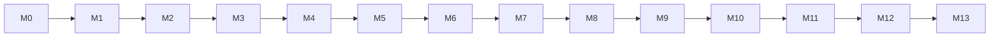

# Kona Framework Plan

Product naming and component map: [components.md](components.md).

GitHub org **`konaframework`** is ready. Primary repo: [`konaframework/kona`](https://github.com/konaframework/kona). Site: **docs.konaframework.org**. Maven: **`org.konaframework`**.

---

## Milestone working rules (locked — enforce across agents)

These rules are product law. They will live in-repo so every agent and human must follow them.

1. **Milestones may be implemented in parallel when they do not collide.** A collision means shared files, the same module, or a behavioral dependency on another milestone that is not yet on `main`. Each milestone still ships on its own branch and its own pull request. Do not start a milestone that depends on another until that dependency is on `main`. Independent, non-colliding milestones may be coded and reviewed at the same time. After one of them merges, rebase any parallel branch that needs those changes before merging it.
2. **Develop to exhaustion.** Within a milestone’s declared parity scope, implement completely — no “good enough for now,” no deferred core behaviors inside that scope.
3. **100% code coverage** for all production code introduced or touched by the milestone (line + branch via Kover/JaCoCo). CI **fails** the milestone PR if coverage &lt; 100% on in-scope modules.
4. **Regression suite.** Every milestone adds/extends automated tests; the full suite for all *completed* milestones must stay green. No merge that breaks prior milestones.
5. **Slice parity gate.** A milestone is done only when its checklist shows **100% parity** with the corresponding **Laravel and/or Almasix** surface for that slice (behavioral/API shape — not PHP/Python source identity). Prefer Almasix where both exist and Kona’s DX should match your stack; use Laravel as the named equivalent for gaps.
6. **Commit + automerge.** Open a milestone PR → required CI (tests, coverage, regression, Kotlin+Java samples) → automerge to `main`. Each milestone keeps its own branch and pull request.
7. **No engine pivots.** From-scratch Kona only; no Quarkus/Micronaut/Spring under the hood.
8. **Kotlin-first, Java first-class.** Every milestone that ships public API includes Java-callable usage and a Java sample/regression path.

### Agent lock-in (files committed in M0)

| File | Purpose |
|------|---------|
| [`AGENTS.md`](../../AGENTS.md) | Always-on agent instructions: milestone rules, coverage, parity, no cross-milestone scope creep |
| [`.cursor/rules/kona-milestones.mdc`](../../.cursor/rules/kona-milestones.mdc) | `alwaysApply: true` Cursor rule mirroring the same laws |
| [`MILESTONES.md`](../../MILESTONES.md) | Ordered milestones, status, parity checklists, Definition of Done |
| [`PLAN.md`](PLAN.md) | This architectural plan (canonical copy in repo) |
| [`components.md`](components.md) | Kona ↔ Laravel/Almasix component map (grind, Cadence, Crema, …) |
| [`.github/workflows/ci.yml`](../../.github/workflows/ci.yml) | From M1 onward: test + 100% coverage gate + regression; automerge on green milestone PRs |

Agents must read `AGENTS.md` + the milestone section in `MILESTONES.md` before writing code. If a request would skip coverage, skip parity, or change GitHub rulesets — **refuse** and finish the milestone in scope (or wait for a human on rulesets). Parallel work that collides, or that depends on a milestone that is not yet on `main`, is still refused.

---

## Decision: Kotlin on the JVM (not Rust); Java as a first-class citizen

**Choose the JVM, implement Kona in Kotlin first, support Java apps equally.**

- Laravel/Almasix DX (container, facades, Eloquent-style ORM, Artisan CLI, providers) maps to the JVM.
- Kotlin for DSLs/null-safety; Virtual Threads for concurrency (not coroutines-first requests).
- Java support is non-negotiable for every public API.
- Not Rust: wrong tradeoff for DX-first near-parity.

## Decision: from-scratch Kona core (not Quarkus or Micronaut under the hood)

**Build Kona from scratch; compose libraries** (Netty, HikariCP, Jackson/kotlinx.serialization, Lettuce, SLF4J). Steal *ideas* (KSP build-time indexes), never embed Quarkus/Micronaut/Spring. Do not vendor competitor applications (Laravel, Spring Boot, FastAPI, …) in this repository.

## Branding and core component map

| Kona | Laravel / Almasix | Role |
|------|-------------------|------|
| **Kona** | Laravel / Almasix core | Container, routing, boot (`Kona.start(args)`) |
| **grind** | Artisan / `smith` | CLI |
| **steam** | Tinker | REPL (`grind steam`) |
| **Cadence** | Eloquent / Almasix ORM | ActiveRecord ORM + migrations |
| **Crema** | Blade / Prism | Templates `*.crema.html` / `*.crema.kt` |
| **drip** | HTTP client | Fluent client/SDK |

```text
./grind | ./grind steam | Cadence | Crema views | Kona.start(args)
```

## Language policy

| Concern | Policy |
|---------|--------|
| Internals / default scaffold | Kotlin |
| Alternate scaffold | Java |
| Public API | Java + Kotlin |
| Concurrency | Virtual Threads |
| Build | Gradle KTS, JVM 21+, multi-module |
| GroupId | `org.konaframework` |

## GitHub layout

Org **`konaframework`**. Monorepo **`kona`**. Later: `kona-app`, `docs`, `ide-support`, `website` → docs.konaframework.org.

```text
kona/
├── AGENTS.md
├── MILESTONES.md
├── .cursor/rules/kona-milestones.mdc
├── docs/architecture/PLAN.md
├── modules/   # core, http, extract, crema, drip, grind, …
├── skeletons/ # kotlin/, java/
├── samples/   # hello-kotlin/, hello-java/ — checked-in api-shaped apps (src/main/…); kits via `kona new`
└── .github/workflows/
```

Trunk: `main`. SemVer via BOM. Apache-2.0. Milestone branches: `milestone/M0-plan`, `milestone/M1-kernel`, …

## Milestones (exhausted)

Canonical checklists and the **full Almasix menu coverage ledger** live in [`MILESTONES.md`](../../MILESTONES.md). Summary:

| # | Focus |
|---|--------|
| M0 | Plan + rules lock |
| M1 | Kernel + HTTP + grind (routing, requests, middleware, validation, …) |
| M2 | Cadence ORM + DB (query builder, migrations, seeders, factories, …) |
| M3 | Session, auth, hashing, passwords, authorization, CSRF, CORS, rate limit, encryption, API tokens |
| M4 | Cache, Redis, Collections, Helpers, Dates, Strings, Localization, Cadence serialization/events |
| M5 | URL generation, API Resources, controllers/logging/errors deepen |
| M6 | Crema views (full view menu) |
| M7 | Queues, events, mail, notifications, filesystem |
| M8 | grind console, prompts, scheduling, packages, steam |
| M9 | Testing harness, drip, processes, concurrency |
| M10 | Broadcasting, search |
| M11 | Reactive UI — **Wire** (Livewire / Conduit parity); rename → **Kona Wire** in M26 |
| M12 | Inertia, asset bundling, starter kits |
| M13 | Language support, LSP, editor setup |
| M26 | **Kona Wire** — rename Brew → Wire; release train **0.3.0** |
| M27 | **Cadence Document / MongoDB** — Kona **1.x**, human-gated (not an M25 SQL engine) |



## Architecture principles (summary)

1. From-scratch core; library composition only.
2. Netty + Virtual Threads (default `KonaHttpServer` adapter).
3. Providers + facades; KSP where useful.
4. Cadence/Crema/drip first-party.
5. Interop gate every coding milestone.
6. Milestone rules above override convenience.

## Decision: MongoDB is Cadence Document (1.x), not a SQL grammar

Relational Cadence is JDBC + Hikari + `Grammar` (M25). MongoDB does not speak SQL. Kona will still treat it as **Cadence** — same product, document models, optional `kona-cadence-mongo` — rather than a second ORM name. Details and the human gate: [`MILESTONES.md` M27](../../MILESTONES.md#m27--cadence-document--mongodb-kona-1x).

## Non-goals (until their milestone)

- Rust/Actix latency race; Spring/Quarkus embedding; coroutines-first HTTP; Kotlin-only APIs. Application panels are **Kona Firefly** (M28+), not a separate Orbit product.
- MongoDB / other document stores before a human activates **M27** (Kona **1.x**).

## Immediate execution order

1. Confirm **active** milestone in `MILESTONES.md` (currently M3).
2. Exhaust that milestone under the locked rules → PR → automerge → next, through **M13** ([continuous-autopilot.md](../governance/continuous-autopilot.md)).
