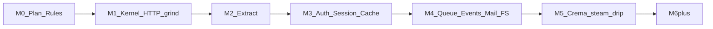

# Kona Framework Plan

Product naming and component map: [components.md](components.md).

GitHub org **`konaframework`** is ready. Primary repo: [`konaframework/kona`](https://github.com/konaframework/kona). Site: **konaframework.dev**. Maven: **`dev.kona`**.

---

## Milestone working rules (locked — enforce across agents)

These rules are product law. They will live in-repo so every agent and human must follow them.

1. **One active milestone at a time.** Do not start the next milestone until the current one is merged to `main`.
2. **Develop to exhaustion.** Within a milestone’s declared parity scope, implement completely — no “good enough for now,” no deferred core behaviors inside that scope.
3. **100% code coverage** for all production code introduced or touched by the milestone (line + branch via Kover/JaCoCo). CI **fails** the milestone PR if coverage &lt; 100% on in-scope modules.
4. **Regression suite.** Every milestone adds/extends automated tests; the full suite for all *completed* milestones must stay green. No merge that breaks prior milestones.
5. **Slice parity gate.** A milestone is done only when its checklist shows **100% parity** with the corresponding **Laravel and/or Almasix** surface for that slice (behavioral/API shape — not PHP/Python source identity). Prefer Almasix where both exist and Kona’s DX should match your stack; use Laravel as the named equivalent for gaps.
6. **Commit + automerge, then next.** Open a milestone PR → required CI (tests, coverage, regression, Kotlin+Java samples) → automerge to `main` → only then begin the next milestone branch.
7. **No engine pivots.** From-scratch Kona only; no Quarkus/Micronaut/Spring under the hood.
8. **Kotlin-first, Java first-class.** Every milestone that ships public API includes Java-callable usage and a Java sample/regression path.

### Agent lock-in (files committed in M0)

| File | Purpose |
|------|---------|
| [`AGENTS.md`](../../AGENTS.md) | Always-on agent instructions: milestone rules, coverage, parity, no cross-milestone scope creep |
| [`.cursor/rules/kona-milestones.mdc`](../../.cursor/rules/kona-milestones.mdc) | `alwaysApply: true` Cursor rule mirroring the same laws |
| [`MILESTONES.md`](../../MILESTONES.md) | Ordered milestones, status, parity checklists, Definition of Done |
| [`PLAN.md`](PLAN.md) | This architectural plan (canonical copy in repo) |
| [`components.md`](components.md) | Kona ↔ Laravel/Almasix component map (grind, Extract, Crema, …) |
| [`.github/workflows/ci.yml`](../../.github/workflows/ci.yml) | From M1 onward: test + 100% coverage gate + regression; automerge on green milestone PRs |

Agents must read `AGENTS.md` + current milestone section in `MILESTONES.md` before writing code. If a request would skip coverage, skip parity, or start the next milestone early — **refuse and finish the current milestone**.

---

## Decision: Kotlin on the JVM (not Rust); Java as a first-class citizen

**Choose the JVM, implement Kona in Kotlin first, support Java apps equally.**

- Laravel/Almasix DX (container, facades, Eloquent-style ORM, Artisan CLI, providers) maps to the JVM.
- Kotlin for DSLs/null-safety; Virtual Threads for concurrency (not coroutines-first requests).
- Java support is non-negotiable for every public API.
- Not Rust: wrong tradeoff for DX-first near-parity.

## Decision: from-scratch Kona core (not Quarkus or Micronaut under the hood)

**Build Kona from scratch; compose libraries** (Netty, HikariCP, Jackson/kotlinx.serialization, Lettuce, SLF4J). Steal *ideas* (KSP build-time indexes), never embed Quarkus/Micronaut/Spring.

Benchmark Spring Boot / Quarkus as competitors only.

## Branding and core component map

| Kona | Laravel / Almasix | Role |
|------|-------------------|------|
| **Kona** | Laravel / Almasix core | Container, routing, boot (`Kona.start(args)`) |
| **grind** | Artisan / `smith` | CLI |
| **steam** | Tinker | REPL (`grind steam`) |
| **Extract** | Eloquent / Almasix ORM | ActiveRecord ORM + migrations |
| **Crema** | Blade / Prism | Templates `*.crema.html` / `*.crema.kt` |
| **drip** | HTTP client | Fluent client/SDK |

```text
./grind | ./grind steam | Extract | Crema views | Kona.start(args)
```

## Language policy

| Concern | Policy |
|---------|--------|
| Internals / default scaffold | Kotlin |
| Alternate scaffold | Java |
| Public API | Java + Kotlin |
| Concurrency | Virtual Threads |
| Build | Gradle KTS, JVM 21+, multi-module |
| GroupId | `dev.kona` |

## GitHub layout

Org **`konaframework`**. Monorepo **`kona`**. Later: `kona-app`, `docs`, `ide-support`, `website` → konaframework.dev.

```text
kona/
├── AGENTS.md
├── MILESTONES.md
├── .cursor/rules/kona-milestones.mdc
├── docs/architecture/PLAN.md
├── modules/   # core, http, extract, crema, drip, grind, …
├── skeletons/ # kotlin/, java/
├── samples/   # hello-kotlin/, hello-java/, bench/
└── .github/workflows/
```

Trunk: `main`. SemVer via BOM. Apache-2.0. Milestone branches: `milestone/M0-plan`, `milestone/M1-kernel`, …

## Milestones (exhausted, sequential)

### M0 — Plan + rules lock (first commit)

**Parity scope:** N/A (process milestone).

**Deliverables:**

- Create/init `konaframework/kona` if empty.
- Commit canonical architecture plan, component map, `MILESTONES.md`, `AGENTS.md`, `.cursor/rules/kona-milestones.mdc`, README pointing at docs.
- No production framework code required yet (or minimal stub README only).

**DoD:** Docs merged to `main`; agents can enforce rules from a fresh clone.

### M1 — Kona kernel + HTTP + grind (foundation)

**Parity slice:** Laravel Application/Container/Providers/Config/Routing/HTTP Kernel/Middleware/Validation + Artisan `serve`/`make` ≈ Almasix framework/http/routing/console bootstrap.

**Includes:** `Kona.start`, container, providers, config/env, request/response, middleware, router (Kotlin DSL + Java fluent), exceptions, logging, validation, `grind serve`, `grind new`, `grind make:controller`, Kotlin + Java samples.

**DoD:** Full slice parity checklist in `MILESTONES.md` checked; 100% coverage on `kona-core` / `kona-http` / `kona-grind` (in-scope); regression green; automerge.

### M2 — Extract

**Parity slice:** Eloquent / Almasix ORM (models, relations, eager load, soft deletes, casts, query builder, pagination, migrations, seeders, factories).

**Includes:** `grind make:model|migration`, `grind migrate`.

**DoD:** Exhausted ORM slice parity + 100% coverage + regression + automerge.

### M3 — Auth, session, cache

**Parity slice:** Laravel/Almasix auth guards, sessions, cache stores (memory, Redis, file/cookie as applicable).

**DoD:** Same gates.

### M4 — Queue, events, mail, filesystem

**Parity slice:** Jobs/workers/retries/failed jobs, events/listeners, mail/notifications (log+SMTP min), filesystem disks (local + S3-compatible).

**DoD:** Same gates.

### M5 — Crema, steam, drip (+ harness polish)

**Parity slice:** Blade/Prism-class directives; Tinker-class REPL; first-party HTTP client; testing harness + scheduling as in Laravel/Almasix for this wave.

**DoD:** Same gates.

### M6+ — Later exhausted milestones (separate)

Broadcasting, Scout/search, IDE/LSP, Orbit-class admin — each its own milestone with the same rules. Not started until M5 is on `main`.



## Architecture principles (summary)

1. From-scratch core; library composition only.
2. Netty + Virtual Threads.
3. Providers + facades; KSP where useful.
4. Extract/Crema/drip first-party.
5. Interop gate every coding milestone.
6. Milestone rules above override convenience.

## Non-goals (until their milestone)

- Rust/Actix latency race; Spring/Quarkus embedding; coroutines-first HTTP; Kotlin-only APIs; Orbit admin before M6+.

## Immediate execution order (after plan approval)

1. **M0:** Push plan + agent/milestone rules to `konaframework/kona`, PR, automerge.
2. Open `milestone/M1-…` only after M0 is on `main`.
3. Exhaust M1 under the locked rules before any later milestone.
